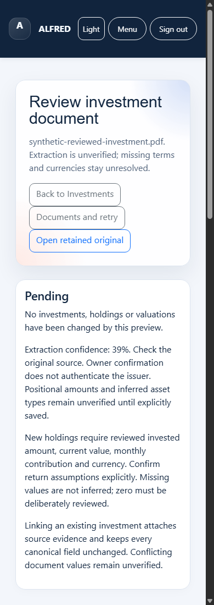

# Review an investment statement

This guide describes the development candidate. The screenshot uses a synthetic
PDF and account; installing the candidate remains separately approved.

1. Open **Investments**, select portfolio PDFs and choose **Extract for Review**.
   Uploading saves a draft and retains the source. It changes no holdings.
2. Select **Review extracted holdings** beside the file. Pending investment files
   also have a review link in the Documents review queue.
3. Open the retained original. Check asset identity, account, invested amount and
   current value. Positional amounts, inferred asset types and return assumptions
   are unverified. Extraction confidence does not authenticate a broker or issuer.
4. Correct missing or inaccurate values. Explicitly enter the currency and monthly
   contribution, including zero when appropriate. Select **Save reviewed values and
   review again**. Original extracted values remain visible. Save every page before
   moving to the next one.
5. Choose **Create**, **Link**, or **Skip** for each row. Matching uses asset name,
   institution and account together. Linking attaches evidence and preserves every
   existing holding field; conflicting document values do not overwrite valuations.
6. Review all pages, select the approval checkbox and **Confirm reviewed investment
   import**. Return to Investments to see the refreshed register and dashboard.
   Reopening or repeating the accepted confirmation cannot post twice.

If a draft, source or matching holding changes, ALFRED rejects the old confirmation.
Reload and review current values. Temporary posting failures roll back canonical
writes and preserve the draft. **Documents → Retry** extracts an unedited source
again; retries cannot post holdings or overwrite saved corrections.

Drafts expire after 24 hours; confirmation tokens expire after 30 minutes. Reopen
the page for a new token. For an expired edited draft, keep its corrections and
upload the retained original again. Original files remain available even if
automatic extraction cleanup is enabled. Removing a source preserves its holding.

The workflow supports up to 100 rows, 10 per page and 2 MiB of structured data,
within existing upload limits. Currency is never inferred or converted. Supported
choices are INR, USD, EUR and GBP; canonical rupee totals keep their existing rules.
This importer creates records or links evidence. Updating an existing valuation
uses the separate, explicit holding-edit controls.
