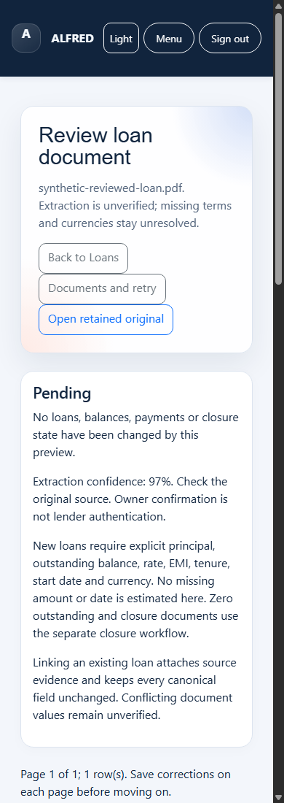

# Review a loan document

This guide describes the development candidate. Installing it over the owner's
application remains separately approved. Screenshots use synthetic data only.

1. Open **Loans**, choose lender PDFs and select **Extract Loan PDFs for Review**.
   Uploading saves an extraction and its original source; it changes no loans.
2. Select **Review extracted loans** beside the source in Loans or Documents.
   Open the retained original and check every field. Extraction confidence does
   not authenticate the lender or verify a balance.
3. Enter missing terms and correct extraction errors. Original values and their
   extracted, missing or owner-entered status remain visible. Currency and dates
   are never inferred. Select **Save corrections and review again** on each page.
4. Choose **Create a new loan**, **Link an existing loan**, or **Skip** for each
   row. Matching loans and conflicting values are shown. Linking preserves every
   existing loan field, including verified balances. Duplicate rows cannot create
   the same account twice. Closing loans uses the separate closure workflow.
5. Review all pages, select the approval checkbox, then **Confirm reviewed loan
   import**. Return to Loans to see the refreshed register and dashboard. Reopen
   the source from Documents to view its confirmed review without posting again.

If a source, matched loan or draft changes, confirmation is rejected. Reload and
review the current values. A temporary failure rolls back the canonical writes;
the draft remains available for retry. Repeating an accepted confirmation returns
its receipt without creating another loan.

Drafts expire after 24 hours and confirmation tokens after 30 minutes. Reopening
renews the token. **Documents → Retry** prepares a new extraction for an unedited
draft; it cannot post loans or overwrite saved corrections. For expired edited
drafts, retain the corrections and upload the original again. Original files are
retained even when automatic extraction cleanup is enabled. Removing a reviewed
source, including a legacy upload, does not delete its canonical loan.

The bounded workflow supports 100 loan rows, 10 rows per page and 2 MiB of
structured extraction, subject to existing upload limits. Supported currencies
are INR, USD, EUR and GBP. Only existing canonical INR rules feed rupee totals;
there is no currency conversion. Sources that cannot supply reliable terms stay
unresolved until explicitly corrected or skipped.
