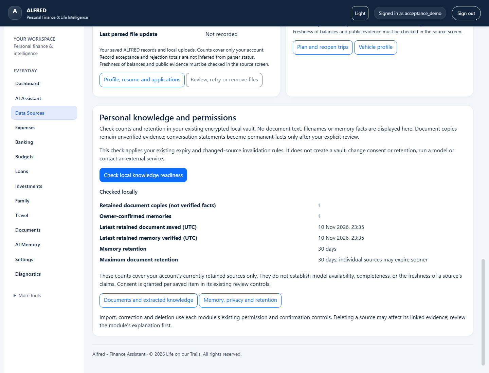
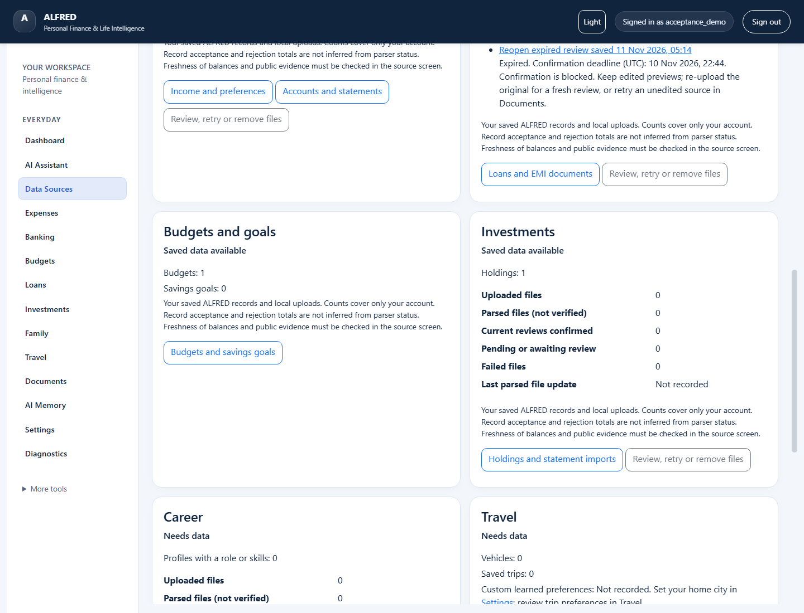
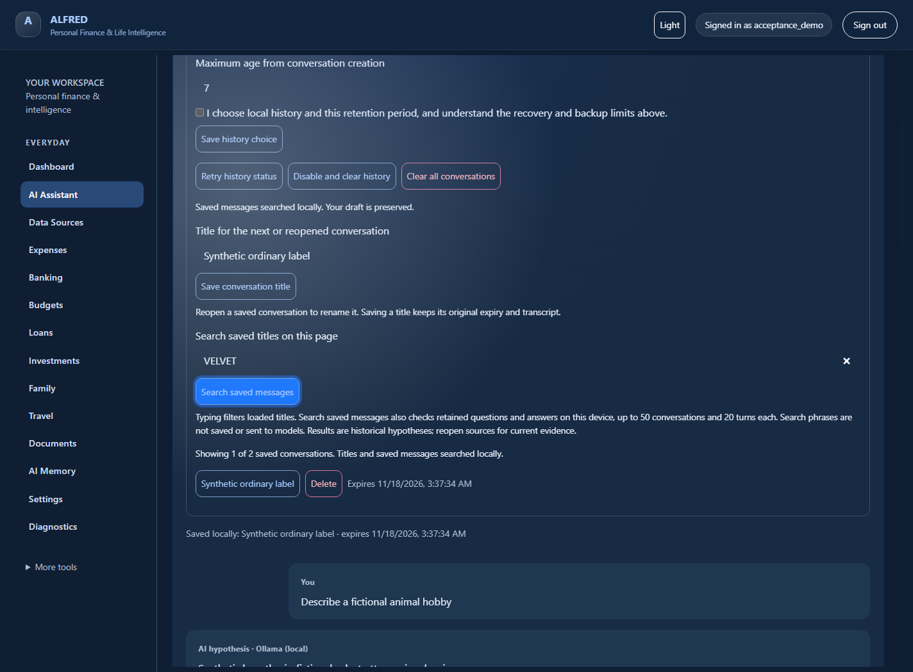
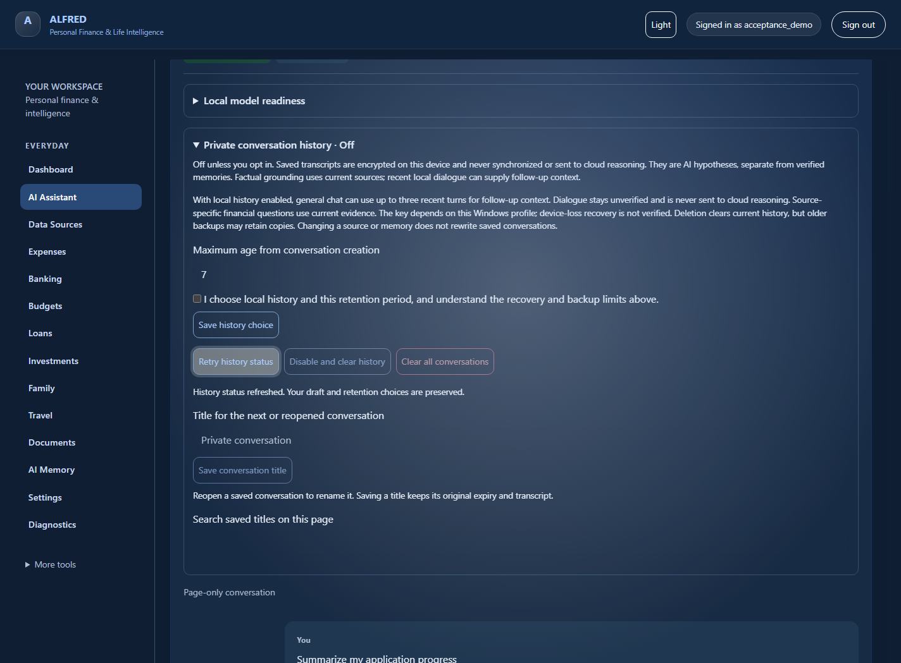
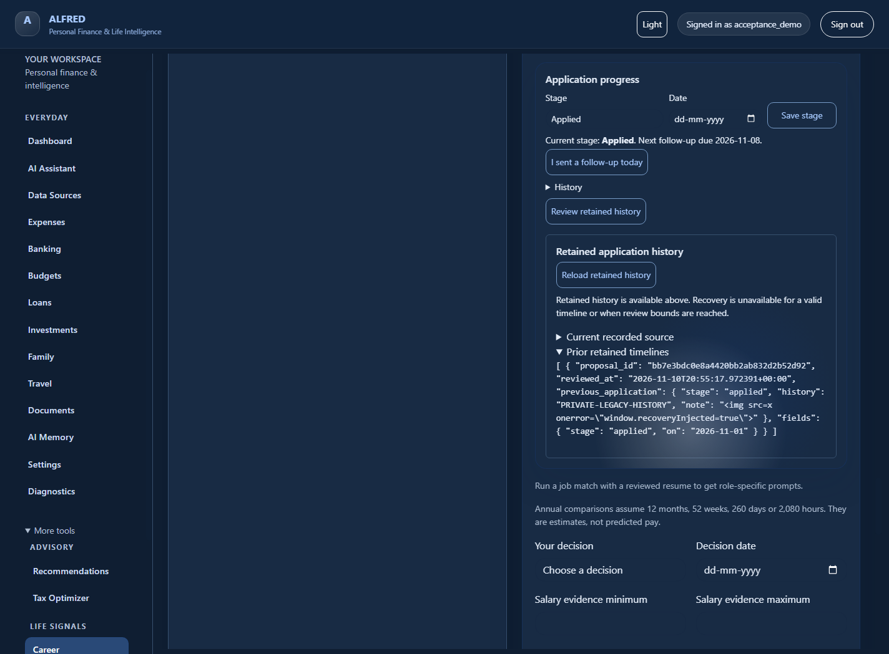
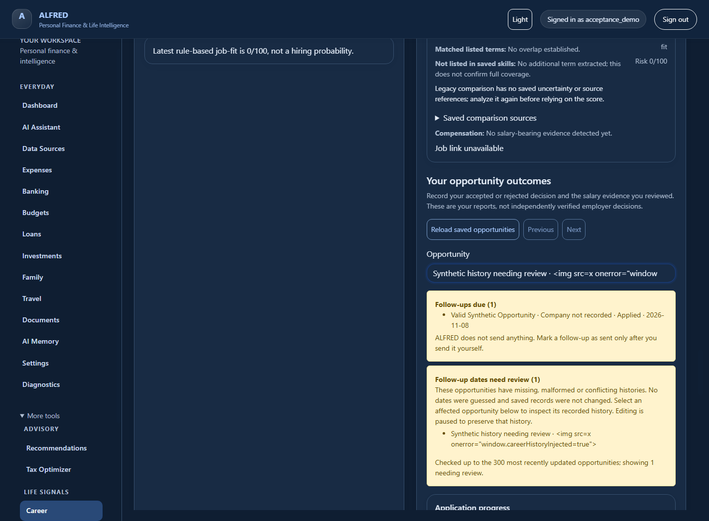
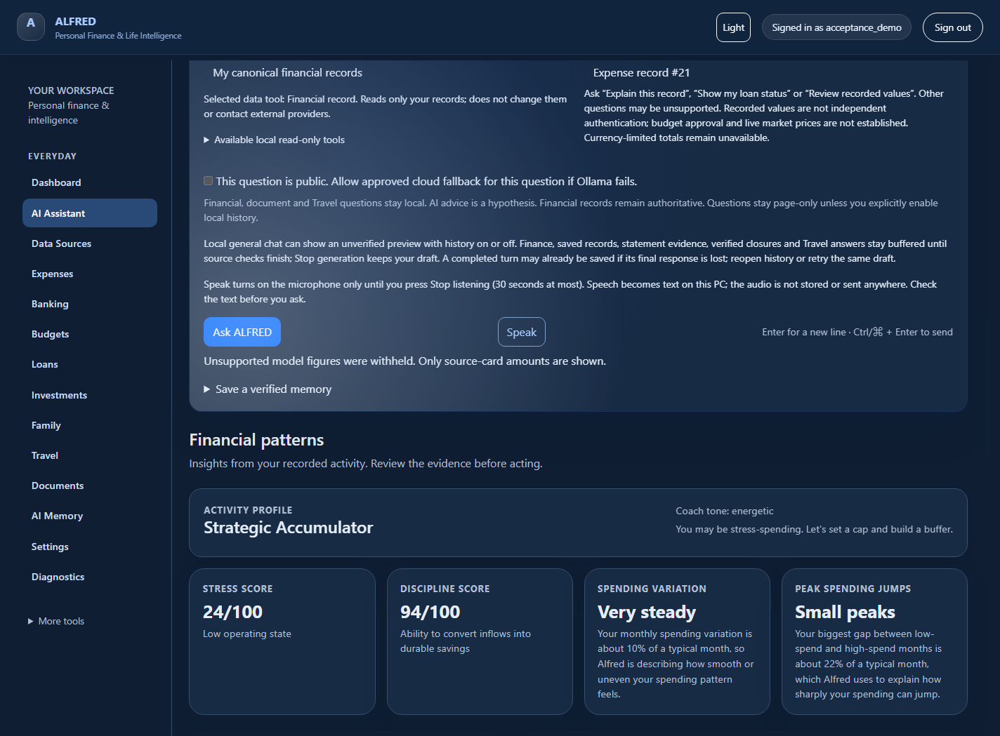

# Using the local assistant

In **Data Sources**, choose **Check local knowledge readiness** to see your retained
document and owner-confirmed memory counts, latest save times and retention limits.
Opening the page leaves private storage unopened. The explicit check uses the
existing expiry and changed-source rules; document copies remain unverified evidence.
It runs locally without inference or external services. Use **Documents** to review,
add or remove consented sources, and **Memory, privacy and retention** for facts and
retention controls. An unavailable vault needs existing recovery controls and its
protected key backup; the check never creates replacement keys.

Pending bank, loan and investment reviews in **Data Sources** show their confirmation
deadline. **Reopen expired review** opens the retained preview with confirmation
blocked. Keep edited previews and re-upload the original for a fresh review; retry
an unedited source in **Documents**. An unavailable deadline needs inspection in the
source review. The center does not extend deadlines or retry an import automatically.

With approved local history enabled, type in **Search saved titles on this page**
to filter titles immediately. Choose **Search saved messages** to also find text
inside retained questions and answers, then reopen a matching conversation.
Search stays on this device, uses no AI provider and creates no plaintext index.
It scans at most 50 conversations with 20 turns each; expired or deleted history
cannot be found. Search phrases clear on navigation/reload. Saved answers remain
historical hypotheses, so reopen source records for current evidence.

If private history status is unavailable, page-only **Career application progress**
and **Reviewed records from one document** can still use their selected local sources.
Open **Private conversation history** and choose **Retry history status** to check
again without losing your draft or changing retention consent. General chat waits
for known status. A changed saved conversation must still be reopened before resuming.
Source ownership, current revisions and sign-in remain required.

Under **Include local records**, choose the records to use for this question.
The permission note names the selected read-only data tool. Expand **Available
local read-only tools** to see the current catalogue. These tools read your own
Finance records, reviewed statement/document evidence, recorded Career application progress or saved Travel preferences;
they do not make changes, book travel, trade or contact external providers.
General chat keeps its existing verified-memory and conversation controls.

If a local source read cannot return validated evidence within its budget, your
question stays in the composer. Review or reload the source, then retry. Database
and file reads finish safely; ALFRED discards late results. External MCP servers
are not enabled by this catalogue. New actions still require their separate review
and confirmation flow.

For application progress, choose **My recorded Career application progress**, then
ask "Summarize my application progress". You can also use **Review application
progress with ALFRED** on Career. The snapshot shows recorded stages and follow-up
dates, with scan limits and missing dates explained. **Open source records** returns
to Career to review or update them. Reopen and ask again to see changes.

Career snapshots stay on the page even when conversation history is enabled.
They work without a model and do not verify that an application or message was sent.
No salary, contacts, resume text or job-description text is included.

If Career shows **Follow-up dates need review**, select the affected opportunity,
then choose **Review retained history and recovery**. Inspect the current source.
Choose a stage and an explicit date you can confirm, then select **Preview recovery**.
Review the new timeline and choose **Confirm recovery and retain original**, or
**Cancel review**. Nothing is sent to employers.

Confirmation starts a new owner-reported timeline. The exact original history stays
under **Prior retained timelines**; its older follow-ups do not count in the new
timeline. Reopen **Review retained history** to inspect it. Normal stage editing
becomes available after recovery. These reports are not independently verified.

Reviews expire after ten minutes and reject changed records or changed fields.
If confirmation is interrupted, retry the same card or reload Career. Each review
can save only once. Recovery supports at most five retained timelines and a bounded
source size; larger or incompatible records stay intact for separate review.

To create a savings goal, ask "add a savings goal Bike of 1000.25". To report
progress, ask "update Bike saved to 250.10". Review the name, amount and date in
the proposal, then choose **Confirm** or **Cancel**. Proposals expire after ten
minutes. If you change the goal elsewhere, ask again to obtain a fresh review.
Cancelled or expired cards cannot change a goal. These actions use the existing
Budgets validation locally and do not require a model or a paid API.

If confirmation is interrupted, retry the **same card** or check **Budgets**.
The same proposal can save only once, including after ALFRED restarts. A repeated
confirmation returns its receipt without overwriting subsequent changes. Reloading
the page clears the visible card; saved goals remain in Budgets. The local action
audit retains a keyed fingerprint and outcome, without the request, goal name or
amount. Clearing that audit makes its old proposals unavailable.

If local AI is unavailable, supported requests such as **Explain this record**
can still display current Finance, Loan, Investment, Budget or reviewed-statement
source cards. Select the owned record under **Include local records**, then ask.
ALFRED labels this as recorded evidence and supplies no model explanation or new
calculation. Open a citation to inspect verification, dates, currency and limitations.
Unsupported questions or changed evidence still require review; this recovery
does not enable cloud access or save a conversation turn.

Open **AI Assistant** from the sidebar. Under **Local answer style**, choose
Automatic, Concise, Detailed explanation, Comparison or Step by step. Enter your
question and press **Ask ALFRED**, or Ctrl+Enter. Automatic follows explicit
requests for brevity, detail, comparisons or steps. Answers have bounded lengths
and deadlines; detailed financial and document replies have a stricter limit.

Completed answers display headings, emphasis, inline code, fenced code blocks,
flat lists, quotes and simple pipe tables. Wide tables and code blocks can be
focused and scrolled with the keyboard. The same formatting appears when you
reopen a saved conversation; the original encrypted transcript is preserved.

Links, images and raw HTML supplied in answer text stay inert text. Verified source
links remain in the separate evidence cards. Questions and unverified streaming
previews remain plain text. Irregular or oversized tables fall back to text so
values are retained. Advanced Markdown and code syntax colouring are not supported.

With private history off, local general-chat follow-ups can use up to three recent
turns from the current page. That dialogue stays in page memory. **New conversation**,
navigation or reload clears it. It is omitted when you choose cloud fallback;
private history remains a separate opt-in with retention and recovery controls.

Local general chat streams an **unverified preview** with history on or off.
Press **Stop generation** to cancel, including by keyboard. Stop, timeout or a
broken connection preserves the draft and labels any preview **Partial, unverified**.
It has no source links, memory promotion or history-save controls. Use **Retry**
to request a complete answer. If the output limit is reached, choose Concise or
narrow the question. Partial previews never enter saved history. With approved
history enabled, only completed, validated local answers are retained. If the final
response is lost after saving, **Retry** the same draft to recover its saved answer
without another turn or model call. A stopped connection may already have a completed
turn saved; reopen history to check. Follow-ups use the same bounded local context.

Figures and source-backed output are buffered until the complete response passes
validation. Source links and accepted answer controls appear only after validation.
Finance, saved financial records, statement evidence, verified loan closures and
Travel preferences also support **Stop generation** during local processing.
Their output stays buffered until source and answer checks finish. Stop preserves
the draft; local source reads finish safely and late results are discarded. Reopen
a citation to inspect the current record. Supported recorded-value questions can
still return canonical source cards when Ollama is unavailable.

Reviewed-record document questions and Career progress keep their fast page-only
responses. Consented cloud fallback retains its complete-response path. History
privacy and financial grounding rules still apply.

If Ollama is unavailable, the draft remains in the composer. Open Settings →
Diagnostics to check local inference, then use **Retry**. External fallback still
requires its separate public-query consent; the answer-style selection controls
local generation.

Private conversation history requires both local operator authorization and your
explicit consent with a retention period. Open the private-history panel to enable
it when available. Saved conversations can be reopened after restarting ALFRED.
The assistant uses a bounded selection of recent general-chat turns for follow-up
questions. Reopened answers are labelled historical and their sources may be stale.

Inside the private-history panel, **Search saved titles on this page** filters
the saved conversation list as you type. It searches titles, without sending the
search text to a server or model. Clear the search to see the full owned list.
Reopen a conversation, edit its title and press **Save conversation title** (or
Enter in the title field). This keeps the transcript and original expiry. If
another window changed it, reopen the conversation before retrying; your unsent
question remains in the composer.

Conversation statements remain unverified dialogue. Saving a conversation never
adds verified memory facts or changes your financial records. For document or
financial questions, select the owned source and inspect its evidence cards.
Unsupported numeric or currency claims are withheld from AI prose. Check missing
evidence rather than treating a longer answer as greater certainty.
