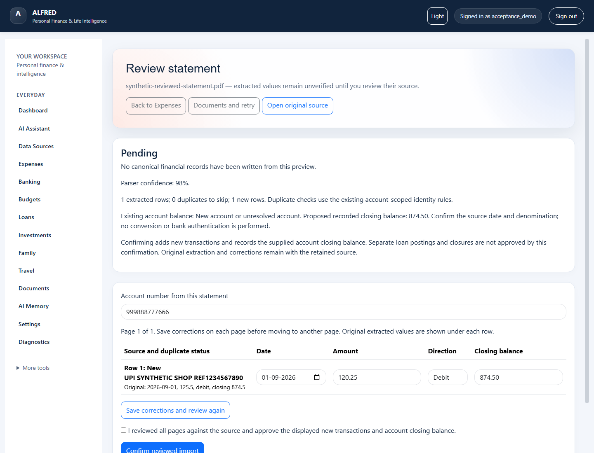

# Review and import a bank statement

This guide describes the current development candidate. Installation of that
candidate on the owner's runtime remains separately approved. The screenshot uses
a synthetic account and PDF; it contains no owner data.

1. Open **Expenses** or the **Statements** section of **Documents**. Choose a PDF
   and select **Extract for review** (or the statement upload button in Documents).
2. Open **Review extracted rows** beside the uploaded file. Extraction saves a
   preview and retains the source. It does not create accounts or transactions.
3. Open the original source. Check the account number, date, amount, debit/credit
   direction and closing balance. Parser confidence describes extraction quality;
   it does not authenticate a bank or verify the values.
4. Correct any values and select **Save corrections and review again**. The
   original extracted values remain visible under each row. Save each page before
   moving between pages; up to 100 rows appear on a page.
5. Review the displayed new/duplicate counts and proposed account closing balance.
   Select the review checkbox, then **Confirm reviewed import**. The existing
   canonical services add new transactions and record the supplied closing balance.
6. Return to Expenses to inspect the account and dashboard. Reopening a confirmed
   preview shows its confirmed status. Repeating the same confirmation returns its
   receipt without posting again.

Separate loan postings and closures are not approved by statement confirmation.
Currency is not inferred or converted. If an account or source changed while you
reviewed it, ALFRED rejects the stale confirmation; reopen the preview and check
the current values. An edited preview is preserved when retry is requested.

For a partial extraction, review the partial-page notice. **Documents → Retry**
prepares a new extraction for review; background processing cannot post its rows.
An extraction expires after 24 hours and a confirmation token after 30 minutes.
If confirmation expires, reopen the page; if the extraction itself expired, retry
the original. For an expired edited preview, keep its corrections and re-upload
the original as a new source. Sources and confirmation receipts are retained.

This bounded importer supports up to 2,000 extracted rows and an 8 MiB structured
extraction. Oversized or unreadable input is reported; missing balances are not
guessed. Other module imports have their own workflows and acceptance status in
the [usability milestone](ALFRED_USABILITY_INTEGRATION.md).
